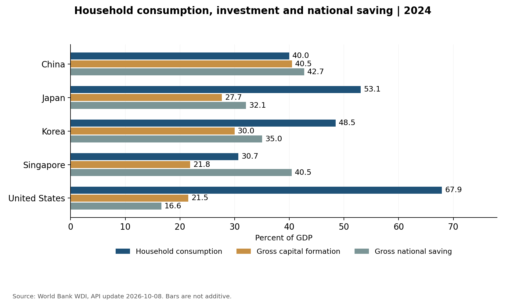
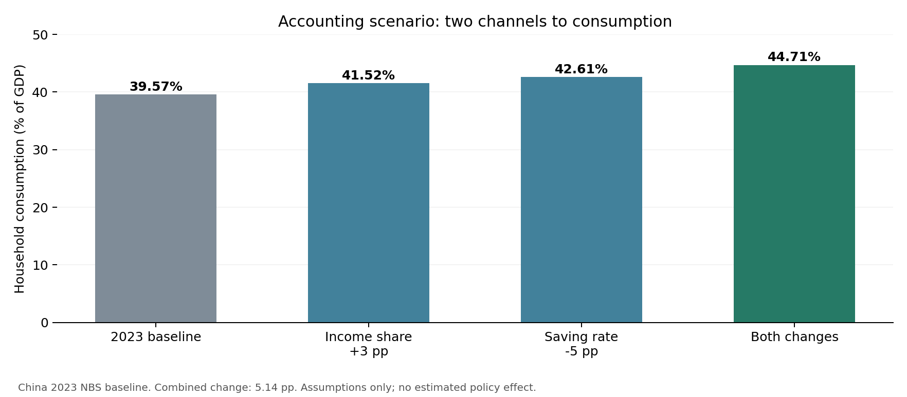

# 从资本积累到居民福利
## 中国高储蓄与消费转型的部门账户和财政制度分析：中、日、韩、新加坡与美国的比较研究

**研究工作论文 · 第1.0版 · 2026年10月22日**  
**研究发起与发布：deepbule0；资料整理与写作：ChatGPT辅助。**  
本文为公开讨论的比较宏观经济与财政研究，不是已经通过同行评审的期刊论文。正文提出可检验的论点，未进行新的微观因果估计。中英文版本的论证、数据和政策假设一致。

### 摘要

中国的消费转型不能仅被解释为居民储蓄偏好问题。本文以部门收入账户和财政制度为框架，比较中国、日本、韩国、新加坡与美国，区分储蓄与存款、总储蓄与净储蓄、国内储蓄与国民储蓄，以及居民收入内部的储蓄倾向与居民在国民收入中的份额。世界银行2024年同一数据快照显示，中国居民消费占GDP约40.0%，资本形成占40.5%；新加坡居民消费占比更低，但其生产、跨境收入和公共资产结构与中国显著不同。国家统计局2023年资金流量表显示，中国住户与企业总储蓄分别约占GDP的21.23%和22.22%，广义政府总储蓄则为负值；住户可支配收入份额在较长期内先降后升，不能把消费偏低归因于该份额持续下降。本文的核心判断是：当一部分新增资本的社会回报下降，而家庭仍承担较大的生命周期风险时，居民收入、风险分担与公共资本收益的制度安排可能滞后于生产能力的发展。比较证据支持这一联合机制，但不足以测定各因素的精确因果贡献。政策应围绕居民实际福利重配财政支出、完善中央与地方的收入及支出责任、提高公共资本收益的透明度，并保护高社会回报投资。全球层面，各国不能共同依靠顺差消化储蓄；可持续转型要求顺差经济体扩大适宜内需，赤字经济体恢复财政约束，同时把长期资金导向具有真实回报的全球投资。

**关键词：** 部门储蓄；居民消费；收入分配；财政联邦关系；公共资本；全球失衡  
**JEL分类：** E21、E22、E62、H50、H63、O11

### 1. 问题、研究方法与评价标准

一个社会把当期产出分配给消费、资本形成和对外净供给，决定了当代人与未来人的生活机会。储蓄能支持教育、基础设施、科研和风险准备；消费则实现生产成果的使用价值。因此，储蓄率或消费占GDP的比例，都不能脱离发展阶段、资本回报与分配制度，独立成为经济成败的标准。

本文采用比较制度分析与可复核的国民账户描述。国际总量比较固定使用世界银行WDI的2024年数据；部门账户使用能够核对的国家统计资料，并逐项标明年份、部门边界及总净口径。文献和政策报告提供机制证据，本文不把跨国相关性当作政策的因果估计。资料检索截至2026年10月22日，较新的政策报告用于诊断，但正文不是对2026年全部统计发布的实时汇编。

评价标准是**居民跨期、经风险调整的福利**：实际消费与公共服务、健康和教育、就业稳定、闲暇、分配公平以及生态和财政可持续性。这是一项明确的规范选择，而不是声称存在没有价值判断的“最高立场”。消费转型的目标，是提高这些福利的实现能力；使消费占比上升只是可能的结果之一。

### 2. 文献线索与必须统一的核算概念

既有研究并不支持把中国储蓄简单归结为单一文化特征。Chamon与Prasad研究了住房、教育、医疗支出责任变化；Chamon、Liu与Prasad讨论收入不确定性及养老金改革；Xu等人的近期研究关注农村社会支出、户籍和房地产调整。它们研究的样本、时期及识别方法不同，本文只据此判断这些机制具有经验依据，不移植其系数作为2026年的确定参数。[8-10]

企业储蓄也不是中国特有现象。Chen、Karabarbounis与Neiman记录了全球企业储蓄的上升，提示居民与企业收入分配需要共同研究。[11] 本文在此基础上，把财政风险分担与公共资产收益纳入同一个解释框架。

#### 2.1 储蓄是流量，存款和现金是资产存量

储蓄是一个时期内收入与消费的差额。银行存款增加，可能来自储蓄、卖出其他资产或新增借款；买股票和还贷款也可能使用储蓄。企业持有的现金存量既不等于当年的储蓄，也不等于可以无成本分配的利润。房价或股价的资本利得通常不计入当期储蓄，虽然会影响消费决策。

#### 2.2 分清分母、总净口径与部门边界

| 指标 | 分母或计算方法 | 回答的问题 |
| --- | --- | --- |
| 居民储蓄率 | 居民储蓄 / 匹配口径的可支配收入 | 居民收入中保留多少 |
| 居民储蓄占GDP | 居民储蓄 / GDP | 居民储蓄的宏观规模 |
| 企业储蓄占GDP | 企业储蓄 / GDP | 企业当期积累的宏观规模 |
| 总储蓄与净储蓄 | 净储蓄 = 总储蓄 - 固定资本消耗 | 是否包含资本折旧 |
| 国内总储蓄 | GDP - 全部最终消费 | 国内产出中未用于最终消费的部分 |
| 国民总储蓄 | 国民可支配总收入 - 全部最终消费 | 本国居民部门可支配收入中的积累 |

公司部门一般应区分非金融公司S11与金融公司S12；住户S14与为住户服务的非营利机构S15是否合并，也必须注明。国企与民企是所有制分类，不能用企业部门总量识别国企的储蓄或效率。

依据与本文历史数据相适用的国民账户框架，养老金权益变化调整D8可能进入住户储蓄账户。令 Yh* = 住户可支配收入 + D8，Sh = Yh* - Ch，sh* = Sh / Yh*，则有精确的分解：

`Ch / GDP = (Yh* / GDP) × (1 - sh*)`

这里的星号表示本文为匹配储蓄率所作的养老金调整，不是另一个统计概念“调整后可支配收入”。后者还包括实物社会转移，必须与居民实际最终消费相匹配。政府提供的教育和医疗服务可能提高居民实际消费，而没有等额提高居民自己支付的最终消费。[3-4]

国民储蓄是国内各机构部门储蓄的合计。完全一致的国民账户与国际收支账户下，国民储蓄减资本形成对应经常账户差额；资本账户中的资本转移和非生产非金融资产交易，又影响净借出/净借入。不同来源的数据不能靠强行调整数字实现这一对应关系。政府储蓄是经常账户概念，财政赤字还涉及资本支出等项目，两者不相等。

最后，银行贷款可以创造存款，不能把储蓄理解成银行放贷前必须收集的一堆固定资金。宏观储蓄与投资的恒等关系是事后核算约束；投资融资、银行资产负债表与实际资源的动员是另外的机制问题。

### 3. 数据事实：相同储蓄总量，可以对应不同社会结构

#### 3.1 五国统一的2024年总量基准

表1全部为占GDP的百分比，使用当前价格、2024日历年数据。C_h包含住户及为住户服务的非营利机构，C_g为政府最终消费，I为资本形成总额，S_n为国民总储蓄，CA为经常账户。[1]

| 国家 | C_h | C_g | 全部消费 | I | S_n | CA |
| --- | ---: | ---: | ---: | ---: | ---: | ---: |
| 中国 | 39.97 | 16.71 | 56.68 | 40.48 | 42.72 | 2.47 |
| 日本 | 53.07 | 20.14 | 73.21 | 27.68 | 32.06 | 4.62 |
| 韩国 | 48.49 | 17.48 | 65.97 | 29.97 | 35.03 | 5.33 |
| 新加坡 | 30.68 | 10.05 | 40.74 | 21.85 | 40.45 | 17.20 |
| 美国 | 67.91 | 13.62 | 81.53 | 21.53 | 16.59 | -4.09 |

数据通过世界银行API提取并冻结，API标记的数据库更新时间为2026年10月8日。完整精度值、2000-2024年序列和查询地址见数据附录。消费占比是支出结构指标，并不直接衡量居民福利水平或产出缺口。

*图1：同一WDI快照，单位为GDP的百分比。国民储蓄不是支出法GDP的组成部分，不能与消费、投资直接堆叠。*

新加坡尤其需要区分GDP与国民收入：其国内总储蓄为59.26% GDP，国民总储蓄为40.45%；日本两者分别为26.79%与32.06%。两者差额对应跨境净初次收入和净经常转移的合计影响，不能只凭差额全部归因为跨国公司利润，或全部归因为海外投资收益。这说明居民消费/GDP偏低，还可能涉及国内生产收入归属。

WDI各序列保留其来源和修订差异。例如，新加坡S_n - I - CA约为1.40个百分点，美国约为-0.85个百分点。本文公开报告这些核算残差，不把它们解释为隐藏储蓄、资金外逃或经济机制的证据。

#### 3.2 部门证据：不制造一个实际上并不存在的整齐排名

| 经济体与时期 | 居民证据 | 企业证据 | 可比性限制 |
| --- | --- | --- | --- |
| 中国，2023 | 住户总储蓄/GDP 21.23%；总储蓄/可支配收入34.92% | 非金融与金融企业合计总储蓄/GDP 22.22% | 国家统计局资金流量表；同表GDP作分母 |
| 美国，2024 | 住户及机构总储蓄/GDP 7.07% | 非金融公司与金融商业部门合计约12.00%；广义国内商业部门13.69% | 美联储2026年3月版本；广义口径包含非公司企业折旧 |
| 新加坡，2025 | IMF列示私人住户储蓄/GDP 17.0% | 私人企业储蓄/GDP估计16.8% | 私人部门范围、估计性质及年份均不同 |
| 日本，2024 | OECD日历年居民净储蓄率0.7%；日本官方FY2024为0.8% | OECD指出公司储蓄与国内投资间存在持续较大顺差 | 净储蓄/收入不等于总储蓄/GDP；财政年亦不同 |
| 韩国，2024居民数据 | OECD第118期：居民净储蓄率9.6%（收入为分母） | OECD2024调查指出企业储蓄很高、企业投资未同比例扩大 | 使用报告明确叙述，不以图形目测值充当2024精确数据 |

来源：[2]、[12-16]、[19]、[27]。新加坡部门数字据IMF官方可检索文本；全文访问受限，未将它们用于部门加总或精确跨国排序。韩国和日本尚未建立与中国完全匹配的同年总储蓄部门面板，这一数据缺口保留为研究限制。

另以同一发布版本作居民净储蓄率比较，OECD第118期给出的2024年韩国、美国和日本分别为9.6%、5.7%与2.0%。这些数值均以居民可支配收入为分母；日本2.0%与前表后续报告的0.7%属于不同数据版本，不能混用，更不能把这些净值与中国34.92%的总值直接比较。[27]

中国表内的广义政府总储蓄约为GDP的-0.88%。因此，中国高储蓄不能简单描述为政府部门本身拥有很高正储蓄。公共部门通过国企、金融机构及投资安排影响资源配置，与政府账户当期储蓄是否为正，是两件事。

另一个重要事实是，中国住户可支配总收入占三部门可支配总收入的比例，从1992年的68.9%降至2010年的56.7%，随后回升至2023年的61.2%。这是国民可支配收入的部门份额；同年住户可支配收入/GDP约为60.80%。**居民收入份额与储蓄倾向都值得研究，但现有证据不允许预先断言收入份额持续下降，更不允许预先宣布它一定比储蓄倾向更重要。**[2]

### 4. 核心命题及其证据边界

#### 命题一：文化可以影响选择，但不能单独解释高储蓄的持续性和跨国差异

如果共享某些东亚文化传统就足以决定高居民储蓄，那么日本今天的低净储蓄，以及新加坡强制养老账户的制度作用，都难以解释。这个比较削弱的是“文化决定且政策无效”的强命题，没有排除文化影响，也没有识别文化的数量贡献。

#### 命题二：风险保障的组织方式，比“福利好不好”的笼统判断更重要

税收融资的风险共担、个人强制积累和市场保险，作用不同。总储蓄包含固定资本消耗，企业总储蓄因而不等于可自由分配的净利润。公共养老金可以降低部分自我保险需求，强制个人账户则可能直接增加记录的储蓄。财政未来是否可信、待遇是否覆盖流动就业者、家庭是否有流动资产，也会改变行为。因此，“福利增加必然使储蓄率下降”不是一般规律；政策必须分析净效应与资金来源。现收现付养老金把部分支付责任转移到未来税收和缴费者；它可以改善风险共担，却不会消除老龄化所需的真实资源。

#### 命题三：消费占比有收入份额和消费倾向两条渠道，家庭内部的分配还形成第三条渠道

第2节的恒等式证明两个总量渠道在核算上共同存在，但没有证明谁是外生原因。相同居民收入总额，在高收入和低收入家庭之间分配不同，可能产生不同总消费；实际幅度取决于边际消费倾向、债务、年龄与政策可信度。提高劳动收入、扩大转移支付或提高分红，都需考虑税收归宿及企业投资反应，不能把部门之间的转移自动等同于国民收入增加。

#### 命题四：高储蓄只有相对于投资机会、风险准备和实际资源约束，才可能被称为“过高”

当私人部门希望增加净资产，而具有正社会净现值的国内投资不足以吸收其意愿，外部又不能无限提供需求时，经济可能通过收入下降、财政赤字或对外顺差完成事后平衡。这是机制假说，不是“每一元储蓄都造成需求不足”的定理。反方向同样成立：弱需求会降低预期回报、延后投资并提高谨慎储蓄。

因此，判断中国是否存在过度积累，需要项目回报、产能利用率、价格与工资、债务质量和居民风险指标共同佐证。产业安全、基础研究、绿色转型的社会回报可能高于企业账面利润；不能据单一资产收益率否定公共投资。

#### 命题五：核心困难可能是收益与风险的制度分配滞后，而非生产能力不足

综合以上事实，本文提出的中心命题是：**当生产能力增长较快、部分边际投资回报下降时，如果劳动者及居民获得稳定收入和公共保障的制度没有相应演进，资本积累与居民福利之间就可能形成持续的转换障碍。**

其可观察推论是：更稳定的基本待遇和就业预期，应在控制人口与收入后改善消费；公共资本收益更透明地进入居民福利预算，应提高福利而不必依赖资产泡沫；有序退出低回报项目，应改善资本效率。相反，如果待遇提高而家庭储蓄长期完全不变，或新增投资持续呈现高社会回报且需求不弱，中心命题的适用范围就需要缩小。

### 5. 中国：消费转型为什么也是财政制度转型

#### 5.1 三个相互强化的环节

第一，住房资产调整与收入不确定性可能增强家庭资产负债表修复意愿。第二，居民支出疲弱会压低部分企业的销售预期与投资回报。第三，地方土地相关收入下降与债务压力，可能约束公共服务和欠款清偿，进一步影响收入与信心。这一反馈在各地强度不同，不能把全国总量推断为每家企业或每户居民的状况。

近期世界银行报告仍将家庭谨慎支出、财产状况和收入风险联系起来；其2026年7月报告列示一季度实际居民消费增长2.6%，并报告四季度移动平均口径的储蓄率32.4%。这些是该报告的指标，不与国家统计局年度部门账户34.92%混合比较。[5-6]

#### 5.2 土地财政下降揭示公共服务承诺的融资问题

财政部预算执行报告显示，2025年全国政府性基金预算收入约5.77万亿元，下降7%，主要原因包括地方土地出让收入下降。[23] 2026年1-8月财政数据继续报告土地出让收入下行。[24] 这不等于地方所有经常性财政收入同步下降，也不等于所有地区风险一致。

从公共资产负债表看，土地出让收入不能被视为没有未来机会成本的永久税源。对需要持续兑现的养老、医疗、教育和基本公共服务承诺，财政应配置稳定经常性收入及可预测的转移支付。项目债券融资可以解决现金时点，不能自动产生永久可用的财政资源。

地方政府承担服务支出，却可能面对与流动人口不匹配的收入安排。只宣布居民享有更多服务，而不明确由谁持续筹资，容易形成待遇差异、拖欠和预期不稳。因此，扩大消费的财政改革必须同时决定税收分享、中央承担比例、地区均等化和预算透明度。

#### 5.3 国有资本：研究约束和回报归属，而不是使用笼统制度判断

“国企没有投资收益考核”并非可接受的事实前提。国资委公开介绍的2025年央企经营指标已包含净资产收益率等项目。[26] 真正需要评估的是考核如何执行，政策任务与商业投资如何分账，融资优势及退出机制如何改变边际决策。

应分别评估竞争性企业、自然垄断和公益服务企业的社会职能，并披露合并后的净资产、现金流、财政补贴、担保和收益上缴。提高分红可能支持社保与公共服务，但若伴随等额新增补贴、隐性举债或收费上升，居民的净收益会打折。国有资产总额不能直接当作可以一次性分给居民的财富。

### 6. 五国的宏观与财政比较

#### 6.1 中国：从高强度资本形成走向更完整的居民保障

中国的优势是较强的制造能力、基础设施和产业协同，某些领域仍有很高的有效投资需求。其调整任务是识别回报已经不足的扩张，并使居民收入、保障与服务供给形成可持续增长。制造业升级与消费提升可以相互支持，但新产业产出增长不保证等比例增加就业或工资。

财政重点应从单看投资金额，转向全生命周期的净社会收益和居民获得感。保交付与清偿政府欠款可以修复可信承诺；养老金、医疗和失业保障需要持续制度资金。货币宽松有助于降低融资压力，但当家庭希望还债、企业缺少订单时，其传导效果取决于财政及资产负债表修复。[7]

#### 6.2 日本：低居民储蓄并未自动消除需求问题

日本提示，成熟经济体可以出现低家庭净储蓄与较高国民总储蓄并存。对外净收入与企业部门行为都重要。OECD2026调查指出，日本企业储蓄与投资之间持续存在较大差额。[12] 这使“居民越愿意花钱，宏观问题就自然解决”的解释不充分。

财政分析还必须把老龄化带来的公共支出压力与私人部门净资产需求一起考虑。政策重点应包括真实工资、劳动参与、公共服务效率与企业资本配置。政府可以在需求不足时发挥稳定作用，但长期扩大赤字不能取代养老金、医疗和税制的可持续安排。中国应学习及时处理资产负债表和收入传导问题；日本的历史并不证明中国必然重复相同增长路径。

#### 6.3 韩国：出口企业的竞争力与家庭部门的压力可以并存

韩国拥有强大的全球制造企业，但国家储蓄高不等于普通家庭的消费能力强。OECD2024调查讨论企业储蓄与投资的不对称，2026调查强调高家庭债务、住房可负担性和人口老龄化压力。[14-15] 这些证据支持同时分析企业、家庭和政府。

从财政角度，儿童照护、教育机会、老年保障和劳动市场的可携带福利，应与长期筹资相匹配。改善服务业生产率和中小企业就业质量，可能比进一步扩大同类资本投入更有利于广泛收入增长；其效果仍需具体改革评估。对中国的启示是：工业升级必须通过就业、工资和公共服务传导，不能只依靠企业国际市场份额作为最终评价。

#### 6.4 新加坡：保障也可以通过强制积累与公共资产实现

新加坡的CPF体现了强制个人积累的制度。2026年，符合完整费率条件、55岁及以下雇员的缴费率为雇主17%、雇员20%；缴费基数、年龄和身份限制意味着37%不是全国居民储蓄率。[17] CPF资产对应个人权益和公共部门的相关负债，不能在合并账表时只数资产。

另一方面，财政部的净投资回报贡献规则，允许在规定范围内把长期预期实际投资回报的一部分用于预算。该规则考虑相关净资产及政府负债，提供了积累与代际使用之间的制度连接。[18]

其低居民消费/GDP不证明生活福利低，也不证明消费已达最优。小型国际生产和金融中心的GDP并不全部归本国居民。对中国而言，有价值的经验是可信资产管理、公共服务与规则化收益使用；把巨型经济体改造成同等外部顺差依赖结构，并不是可直接复制的方案。

#### 6.5 美国：消费能力、公共支持与宏观赤字必须合看

美国存在规模可观的Social Security等公共制度，不能描述为完全依靠个人承担养老风险。[21] 个人消费还包括第三方代表个人支付的部分服务，特别是医疗；因此较高PCE不等于同等规模的家庭自由购物支出。[20]

美联储表内2024年政府净储蓄约为-2.05万亿美元；加回政府固定资本消耗后，总储蓄仍为负。[19] 这说明较低国民储蓄不只是“美国家庭爱借钱”，政府账户也很重要。信贷、资产财富和公共转移可支持消费，但它们对不同收入家庭的作用不同。

CBO2026年基线预测中，公众持有联邦债务/GDP在2026-2036年继续上升；这是条件预测而非已经发生的结果。[22] 美国需要在保护弱势家庭与有效公共投资的同时，形成可信的中期财政安排。中国可借鉴风险共担和居民收入传导，不应把低储蓄、资产价格上涨或永久外部融资当作无代价目标。

### 7. 财政政策组合：让居民支持成为可信的长期安排

以下为本文的政策建议，不是已公布的中国政策，也不是对政府意愿或出台日期的预测。

| 改革方向 | 经济机制 | 财政约束与实施条件 |
| --- | --- | --- |
| 提高低保障人群的基本养老、医疗与救助 | 降低灾难性风险，改善高消费倾向家庭的收入 | 明确待遇公式、持续资金与地区均等化 |
| 常住人口可携带公共服务 | 减少流动就业者重复自我保险 | 转移支付随实际服务人口调整，改善数据与责任划分 |
| 住房交付与政府欠款治理 | 修复家庭及企业的可信收入预期 | 承认损失、区分偿付责任，避免普遍托底资产价格 |
| 竞争性公共资本的透明收益使用 | 把资本回报连接到公共福利 | 先扣负债、资本维护与合理投资，防止分红后再补贴 |
| 稳定地方收入、提高税制累进性 | 支持经常性服务，改善分配与财政激励 | 考虑税收归宿、估值能力、过渡安排及住房市场状况 |
| 保护高社会回报投资，退出低效项目 | 改善投资质量和长期生产率 | 独立评估外部收益、全周期成本及替代方案 |

短期稳定与中期结构调整应衔接。低收入支持、欠款清偿与住房交付，往往可以较快改善现金流；养老金可携带性、财政收入调整与公共资本治理需要较长建设。结构性消费能力不可能只靠持续购买同一批耐用品的补贴来建立。若经济已接近实际供给约束，扩大支出可能更多推升价格、进口或挤出其他用途；保障改革的长期福利理由与短期需求刺激效果，应分别评估。

#### 7.1 一个透明的预算压力测试

为说明融资约束，设定一个**纯示意、未经估计的年度经常性支持方案**：新增支出1.5% GDP，通过重配低效支出0.5%、新增稳定净收入0.4%、过渡期中央额外赤字0.6%筹资。三者之和为1.5%，并非对实际可筹规模的判断。

额外赤字是融资，不是收入。如果1.5%的支出永久存在，而0.6%的赤字安排准备退出，就必须找到等额永久收入或进一步节支。国企分红只能计算对合并公共部门的净增量；债务置换主要缓解流动性和利息负担，不能把债务本金都当作新财力。同一政策可能同时改善分配与预防性储蓄，不应重复计算其消费效果。

财政承受力还受名义增长、利率、初始债务、担保和资产损失影响。令d为债务/GDP，r为名义有效利率，g为名义GDP增长率，则近似有：

`d的变化 = [(r - g) / (1 + g)] × 上期d + 初级赤字/GDP + 存量流量调整`

这解释了为何修复价格和收入增长有助于债务稳定，也解释了为什么不能仅凭低利率断言政府可以无限举债。地区能力和中央能力亦不可等同。

### 8. 发展展望：核算潜力、行为反应与政策时序

用2023年国家统计局同表数据作为纯核算起点，住户收入/GDP为60.80%，总储蓄率为34.92%，居民消费/GDP约39.57%。下表保持口径一致，仅改变两个参数，不是预测，也没有假定GDP和收入真的不会受到政策影响。

| 核算情景 | 收入份额变化 | 储蓄率变化 | 居民消费/GDP |
| --- | ---: | ---: | ---: |
| 2023年基点 | 0 | 0 | 39.57% |
| 只提高收入份额 | +3个百分点 | 0 | 41.52% |
| 只降低储蓄倾向 | 0 | -5个百分点 | 42.61% |
| 两者同时变化 | +3个百分点 | -5个百分点 | 44.71% |

合计增加约5.14个GDP百分点，其中收入渠道约1.95、储蓄倾向渠道约3.04、交互项0.15。这个分解证明两条渠道的算术作用，不证明某项1.5% GDP的财政方案就能产生这些变化。跨国差距的因果解释也不能从这个情景反推。

*图2：基于中国2023年同表口径的反事实核算。所有参数变化均为假设。*

未来可以区分三种条件路径。若保障和收入传导改革形成可信承诺、私人投资及就业响应改善，消费与高质量投资可以相互促进。若调整主要停留在商品补贴和投资托底，消费反弹可能更依赖政策时点。若多部门同时加速缩表且外需转弱，收入下降可能抵消个人希望增加储蓄的努力，公共部门就更需要有条件地稳定需求。

不能为这三条路径赋予未经估计的概率，也不能断言中国会在某个具体年份“完成转型”。政策早期应观察待遇覆盖、欠款、实际收入与就业；随后观察消费结构、企业回报和地方经常性收入；更长时期应检查养老金、健康、生态与公共净资产是否可持续。

### 9. 从人类社会整体看：各国不能同时成为净债权人

全球的经常账户原则上加总为零，实际统计存在差额。一个国家的对外净借出，需要另一个国家的净借入相对应。因此，所有国家都依靠出口顺差维持高储蓄，是逻辑上不可能的共同发展策略。顺差不是天生美德，逆差也不是自动失败；关键是跨境资金是否改善借贷双方的长期福利与偿付能力。[4,25]

一个相对协调的方向，是顺差经济体扩大高福利回报的适宜内需，赤字经济体改善财政和国内储蓄，同时维持有效投资。两者如果在同一时间都压缩需求，就可能产生全球收入损失。国际协调因而需要考虑调整速度、汇率、债务与金融稳定，而不能只追求双边贸易余额。

全球层面也不应把“高储蓄”视为普遍坏事。绿色转型、基础科研以及低收入国家的基础服务和基础设施仍有长期资本需求。困难常在项目准备、治理、外汇风险与债务可持续性，使社会需要不能自动变成有融资能力的投资。发展金融、合理风险分担与透明债务可以帮助连接这些需求，但不能把风险转嫁给缺乏偿付能力的人群。

人工智能与自动化进一步突出分配问题：生产率提高本身不能保证就业和广泛购买力同步增长。未来社会更需要把技术回报通过劳动收入、资本参与和公共服务转化为居民能力；同时尊重生态约束，避免用高价格、重复建设或浪费性消费来美化GDP。

### 10. 可检验的研究议程与局限

本文没有“证明”每个机制的精确权重。下一阶段应建立至少覆盖金融与非金融公司、政府、住户和非营利机构的同年部门面板，并统一折旧、养老金调整和跨境收入口径。部门数据可用于描述与分解，仍不能独立识别因果。

具体检验可利用地区待遇或可携带福利的政策变化，采用事前趋势检验、事件研究和合适的差分设计，估计消费、收入、劳动供给及储蓄的共同反应。政策选择本身可能受经济状况影响，因此必须处理选择偏差、同期政策、人口迁移和预期效应，报告异质性与置信区间。对企业应比较边际项目回报及融资成本，而非混用总资产、净资产和利润。

三项主要局限需要保留：第一，五国不能构成识别文化和制度效应的充分样本；第二，企业留存收益与居民资产权益之间存在穿透关系，部门账户不是最终财富归属；第三，本文没有完整计算改革的税收归宿、供给反应及一般均衡效果，政策预算表只是约束展示。

### 11. 结论

五国比较足以否定“高储蓄只有一种来源、一个含义和一个解决方法”的简单叙事。中国的特点在于住户与企业同时形成较高总储蓄，并维持较高国内资本形成；日本、韩国、新加坡和美国分别展示了企业积累、家庭债务、强制账户、公共资产和政府负储蓄等不同组合。

对于中国，值得优先检验和改革的，是**生产成果如何变成广泛且稳定的居民收入，家庭风险如何被有效共担，以及公共和私人资本如何在真实回报约束下配置**。财政政策需要同时处理当期需求、跨期承诺和中央地方责任，避免在消费与投资之间作机械二选一。

从全人类的尺度看，资本积累的正当性来自它所创造的长期生活机会。一个成熟的增长制度，应使生产率、分配、保障、生态与财政能力共同演进；任何单一储蓄率或消费率，都无法代替这个目标。

### 参考文献与可复核材料

编号参考文献、原始数据入口和论点对应见[REFERENCES.md](REFERENCES.md)。口径修正及数据限制见[DATA_NOTES.md](DATA_NOTES.md)，论证演进见[RESEARCH_TRAJECTORY.md](RESEARCH_TRAJECTORY.md)。随附脚本可重新生成表格、图形及核算情景。本文没有使用未经核对的前序对话数字来补齐缺失的部门数据。
